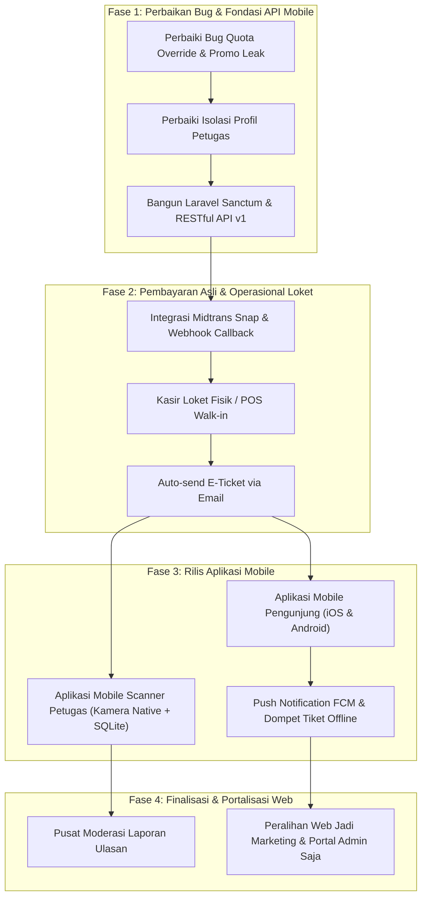

# Roadmap & Evaluasi Fitur Itihasa

Dokumen ini memuat seluruh status fitur aplikasi **Itihasa**, daftar fitur yang telah selesai, temuan kekurangan / bug / inkonsistensi teknis dari setiap peran (*role*), **Strategi Transformasi Arsitektur Web ke Mobile (Mobile-First Transformation)** yang dapat dipahami oleh manusia maupun mesin, serta backlog seluruh fitur yang harus dikembangkan ke depan sebagai acuan revisi dan pengembangan berkelanjutan.

---

## 📱 Transformasi Strategis: Web Monolitik ➔ Ekosistem Mobile (Mobile Migration Strategy)

> [!IMPORTANT]
> **Arah Pengembangan Baru**: Itihasa bertransformasi dari sistem berbasis web monolitik (*Laravel Blade / SSR*) menjadi **Ekosistem Berbasis Mobile (Mobile-First Application)** dengan backend **Headless RESTful API**.

### 1. Penjelasan untuk Manusia (Human-Readable Context & Rationale)
- **Karakteristik Pengunjung (Visitor)**: Lebih dari 90% pengunjung museum mencari info, memesan tiket, dan menunjukkan tiket QR langsung dari smartphone mereka di pintu masuk (*gate*). Aplikasi mobile memberikan pengalaman pengguna yang jauh lebih intuitif (fitur *offline passport stamps*, notifikasi tiket H-1, integrasi peta GPS navigasi museum sekitar, dan tiket QR yang tersimpan di dompet digital tanpa kendala kuota internet).
- **Karakteristik Petugas Lapangan (Gate Officer)**: Petugas gate memerlukan perangkat pemindai (*handheld scanner*) yang ringan, cepat membaca QR code kamera native pada kondisi pencahayaan minim, dan bekerja secara offline sejati (*true offline SQLite storage*) tanpa risiko halaman web ter-reload.
- **Peran Web di Masa Depan**: Portal website tetap dipertahankan secara terarah sebagai:
  1. *Landing Page & Web Marketing* untuk promosi publik dan SEO.
  2. *Executive Web Portal* untuk Super Admin dan Admin Museum dalam mengelola master data, finansial, dan analitik layar lebar.

---

### 2. Penjelasan untuk Mesin (Machine-Readable Architecture & Contract Specification)

```yaml
system_architecture_transformation:
  from:
    paradigm: "Monolithic Web Application (Server-Side Rendering)"
    view_engine: "Laravel 12 Blade + Alpine.js + TailwindCSS v4"
    session_management: "Stateful Web Cookies + Session"
    target_device: "Desktop / Responsive Mobile Web Browser"
  to:
    paradigm: "Headless API-First + Decoupled Client Applications"
    backend:
      runtime: "Laravel 12 (PHP 8.2+)"
      api_protocol: "RESTful JSON API (versioned under /api/v1/)"
      authentication: "Laravel Sanctum Bearer Token (Personal Access Tokens)"
      push_service: "Firebase Cloud Messaging (FCM)"
      payment_gateway: "Midtrans Mobile SDK / Snap WebView + HTTP Webhook Callback"
    clients:
      visitor_app:
        target: "Cross-Platform Mobile (Android / iOS)"
        tech_stack: "Flutter or React Native"
        local_database: "SQLite / Hive / WatermelonDB (Offline Cache & Stamps)"
        hardware_access: ["Camera (AR/QR)", "GPS Geolocation", "Biometric/Secure Storage"]
      gate_scanner_app:
        target: "Android Handheld Device / Smartphone"
        tech_stack: "Flutter or React Native (Optimized for CameraX / Barcode Scanner hardware)"
        offline_engine: "Local SQLite DB + Background Queue Worker (Auto-sync to /api/v1/petugas/sync)"
      management_portal:
        target: "Desktop / Tablet Web Portal"
        tech_stack: "Laravel Blade (Existing) or SPA Dashboard (Super Admin & Admin Museum)"
```

#### Spesifikasi Kontrak API Inti (Mobile API Endpoints Schema)

| Kategori Endpoint | HTTP Method & URI | Header Wajib | Keterangan & Target Konsumen |
|---|---|---|---|
| **Auth** | `POST /api/v1/auth/login` | `Accept: application/json` | Autentikasi email/password, mereturn Sanctum Bearer Token dan detail Role. |
| **Auth** | `POST /api/v1/auth/register` | `Accept: application/json` | Registrasi akun pengunjung baru (Visitor). |
| **Auth** | `POST /api/v1/auth/logout` | `Authorization: Bearer <token>` | Revokasi active personal access token. |
| **Museum Directory** | `GET /api/v1/museums` | `Accept: application/json` | Katalog museum publik dengan filter multi-kriteria (kota, kategori, rentang harga, lokasi terdekat via GPS `lat,lng`). |
| **Museum Detail** | `GET /api/v1/museums/{id}` | `Accept: application/json` | Detail lengkap, galeri foto, jam operasional hari ini, dan ulasan berfoto. |
| **Booking & Quota** | `GET /api/v1/museums/{id}/quota?visit_date=YYYY-MM-DD` | `Authorization: Bearer <token>` | Cek sisa kuota dinamis (memperhitungkan *Daily Quota Override* dan *Blackout Dates*). |
| **Booking Checkout** | `POST /api/v1/bookings` | `Authorization: Bearer <token>` | Submit reservasi tiket, validasi manifes rombongan, dan kalkulasi promo. |
| **Payment Init** | `POST /api/v1/payments/{booking_id}/snap-token` | `Authorization: Bearer <token>` | Menghasilkan token Snap Midtrans resmi untuk eksekusi pembayaran di Mobile SDK. |
| **Payment Callback** | `POST /api/v1/payments/midtrans-webhook` | `X-Signature-Key: <hash>` | Webhook notifikasi Midtrans: mengupdate status transaksi ke `paid` atau `failed`. |
| **User Ticket & QR** | `GET /api/v1/user/tickets` | `Authorization: Bearer <token>` | Daftar tiket aktif pengunjung + QR Code payload terenkripsi untuk pindaian gate. |
| **Gamifikasi** | `GET /api/v1/user/passport` | `Authorization: Bearer <token>` | Data paspor digital, koleksi stempel kunjungan, dan progres 6 lencana wisatawan. |
| **Offline Scanner Sync** | `GET /api/v1/petugas/cache-today` | `Authorization: Bearer <token>` | Mengunduh database tiket hari ini untuk cache offline perangkat scanner petugas. |
| **Offline Scanner Queue** | `POST /api/v1/petugas/sync-offline` | `Authorization: Bearer <token>` | Mengunggah riwayat scan offline dari lokal SQLite perangkat petugas ke database pusat. |
| **Realtime Scanner** | `POST /api/v1/petugas/scan-validate` | `Authorization: Bearer <token>` | Validasi tiket online seketika, checklist manifes rombongan, dan tag catatan gate. |

---

## ✅ 1. Fitur yang Sudah Selesai (Completed Features)

### 👑 Sisi Super Admin (Pengawas Ekosistem & Otoritas Global)
- **Dashboard Monitoring Ekosistem Real-time**:
  - **Penyatuan Metrik Entitas Ekosistem (1 Tampilan Terpadu)**: 4 metrik populasi aktor (Museum Mitra, Admin Museum, Petugas Gate, dan Pengunjung) disatukan ke dalam 1 widget/card ekosistem horizontal yang elegan tanpa terpisah-pisah menjadi 4 kotak grid terpisah, berdampingan dengan metrik Kunjungan Real dan Skor Kepuasan.
  - 8 Metrik KPI global (Omzet nasional, total transaksi paid/pending, okupansi, total museum, users).
  - Grafik tren omzet 6 bulan & donut chart distribusi omzet per museum.
  - Matriks kinerja & penanggung jawab per museum dengan okupansi kuota harian.
  - Live feed transaksi nasional & tombol cetak laporan.
- **Filter Rentang Waktu Fleksibel (Fitur A Super Admin)**:
  - Preset filter: *Semua Waktu*, *Hari Ini*, *Minggu Ini*, *Bulan Ini*, *Tahun Ini*, serta *Kustom Rentang Tanggal*.
  - Menghitung KPI, performa, dan log transaksi secara dinamis sesuai tanggal terpilih.
- **Pusat Broadcast Resmi & Pengumuman Multi-Display (Fitur E Super Admin)**:
  - CRUD & status toggle pengumuman resmi global khusus Super Admin dengan pelacakan status baca per-pengguna (`broadcast_reads`).
  - Target role penerima fleksibel: *Super Admin, Admin Museum, Petugas Gate, Pengunjung (User)*, atau *Semua Role*.
  - Pilihan tipe tampilan sesuai urgensi: **Notification Bell**, **Banner Atas Halaman**, atau **Modal Pop-up (Penting/Darurat)**.
  - Kategori pengumuman: *Operasional, Kebijakan, Pemeliharaan Sistem, Info Tiket, Darurat, Umum*.
- **Pusat Notifikasi & Transaksi Otomatis (Unified Notification Center)**:
  - Notifikasi otomatis terintegrasi langsung pada alur transaksi (Booking dibuat, Pembayaran lunas, Pembayaran gagal/kedaluwarsa, Pembatalan booking, dan Validasi tiket di gate museum).
  - Widget **Notification Bell** interaktif pada navbar (Super Admin, Admin, Petugas, dan Pengunjung) dengan penghitung *unread badge*, pratinjau cepat, aksi *mark as read*, serta halaman riwayat lengkap `/notifications` dengan pemisahan tab transaksi & broadcast resmi.
- **Pemantauan Ulasan Pengunjung Berbintang**:
  - Visualisasi rating 1–5 bintang emas (`★`) pada tabel pantau ulasan (`admin.reviews.index`) menggantikan teks skor biasa.
- **Kontrol Status Operasional & Kemitraan Museum (Fitur C Super Admin)**:
  - Status kemitraan: `Aktif Buka`, `Tutup Sementara / Renovasi`, atau `Nonaktif`.
  - Integrasi proteksi: Otomatis memunculkan banner peringatan resmi dan mengunci form pembelian tiket di halaman publik saat museum berstatus renovasi/nonaktif.
- **Manajemen Akun Admin Museum & Pengguna**:
  - Registrasi dan penugasan akun Admin untuk setiap museum mitra.
  - Pemisahan peran ketat (*Role isolation*): Super Admin fokus pada pendaftaran admin dan pemantauan (*View-Only / Mode Pantau*).
- **Redesain Direktori Museum Super Admin**:
  - Tampilan modern bertema ungu dengan 4 KPI ringkasan museum, multi-filter (*Kategori & Status*), data PIC admin penanggung jawab, dan aksi cepat publik/edit/status.

---

### 🏛️ Sisi Admin Museum (Operasional & Manajemen)
- **Balas Ulasan Pengunjung / Respon Resmi Pengelola (Fitur B Admin)**:
  - Admin Museum dapat memberikan tanggapan resmi (*Official Response*) terhadap ulasan pengunjung.
  - Tampil di halaman publik museum dengan badge **🏛 Respon Resmi Pengelola**.
- **Kalender Hari Libur Khusus & Kuota Dinamis (Fitur C Admin)**:
  - Fitur **Blackout Dates**: Menandai tanggal libur khusus/pemeliharaan lokal sehingga terkunci di form reservasi online.
  - Fitur **Daily Quota Override**: Menyesuaikan kapasitas kuota harian khusus saat periode peak season / hari libur nasional.
- **Rekap Tutup Kas Harian & Ekspor Finansial Loket (Fitur D Admin)**:
  - Laporan tutup kas (*End of Day*): Rekapitulasi perbandingan pembayaran tunai loket vs QRIS/Transfer.
  - Ekspor data transaksi dan manifes pengunjung ke format CSV (UTF-8 BOM Excel-ready) serta format cetak arsip bendahara.
- **Kode Promo & Kupon Diskon Tiket (Fitur E Admin)**:
  - Pembuatan kupon diskon (tipe persentase atau potongan nominal tetap) dengan kuota klaim, minimal belanja, dan masa berlaku.
  - Validasi AJAX interaktif langsung di halaman pemesanan tiket pengunjung.
- **Pengaturan Mandiri Profil & Fasilitas Museum (Fitur F Admin)**:
  - Pengelolaan mandiri deskripsi, alamat, kontak WhatsApp/Telepon, jam operasional mingguan, fasilitas, serta galeri foto museum.
- **Manajemen Akun Petugas Loket**:
  - Admin Museum dapat membentuk dan mengelola akun staf pemindai (*gate officers*) khusus untuk museum binaannya.

---

### 📷 Sisi Petugas Gate / Scanner (Validasi Lapangan)
- **Validasi Manifes Rombongan Bertahap (Fitur A Petugas)**:
  - Pemindaian tiket rombongan (≥6 pax atau tiket grup) dengan checklist manifes per individu di halaman validasi manual.
  - Tiket QR tetap aktif dan progress bar diperbarui secara real-time (*"X dari Y orang sudah masuk"*) hingga seluruh anggota rombongan selesai masuk.
- **Mode Offline Scanner & Auto-Sync (Fitur C Petugas)**:
  - Pengambilan cache data tiket hari berjalan ke *Local Storage* scanner.
  - Penampungan antrean pindaian offline saat koneksi gate drop dan sinkronisasi massal (*Auto-Sync*) ke server saat sinyal pulih.
- **Widget Ringkasan Shift Kerja Petugas (Fitur D Petugas)**:
  - Menampilkan jam mulai bertugas, total pemindaian tiket hari ini, total pengunjung yang telah dilayani, dan status gate aktif.
- **Catatan Pintu Masuk & Label Insiden / Gate Notes (Fitur E Petugas)**:
  - Fitur sematan label cepat (*VIP, Kursi Roda/Disabilitas, Barang Tertinggal, Kompensasi Tiket, Kendala Gate*) dan catatan teks saat validasi tiket.

---

### 🎒 Sisi User / Pengunjung (Eksplorasi, Gamifikasi & Ulasan)
- **Unggah Foto Pengalaman pada Ulasan (Fitur B User)**:
  - Pengunjung dapat melampirkan 1–3 foto pengalaman kunjungan saat memberikan ulasan dan rating bintang.
  - Dilengkapi Lightbox modal interaktif untuk melihat foto ulasan beresolusi penuh.
- **Paspor Digital Museum & Lencana Wisatawan (Fitur C User)**:
  - Stempel digital (*Digital Stamp*) otomatis di halaman profil setiap kali tiket berhasil dipindai oleh petugas gate.
  - Koleksi 6 Lencana Penjelajah (*Explorer Badges*): *"Perintis Budaya"*, *"Penjelajah Sejarah"*, *"Apresiator Seni"*, *"Pecinta Sains & Bumi"*, *"Mahapatih Nusantara"*, dan *"Kurator Visual"*.
  - Level penjelajah bertingkat (*Perintis Pemula*, *Wisatawan Muda*, *Penjelajah Madya*, *Mahapatih Budaya*).
- **Rekomendasi Rute Wisata & Destinasi Terdekat (Fitur D User)**:
  - Modul *One-Day Cultural Trail* pada detail museum: merekomendasikan museum terdekat di area yang sama, lengkap dengan estimasi jarak, waktu tempuh, status buka/tutup, dan tombol rute Google Maps.
- **Filter Cepat Berdasarkan Kota, Kategori & Rentang Harga (Fitur F User)**:
  - Fitur pencarian multi-kriteria di homepage: Filter instan berdasarkan Kota (*Bandung, Jakarta, Yogyakarta, Solo, dll.*), Kategori (*Sejarah, Seni & Galeri, Budaya, Alam & Sains, Religius*), dan Rentang Harga (*Gratis, ≤ 25k, 25k-50k, > 50k*).
  - Quick filter chips 1-klik dan tombol reset filter.
- **Fitur Pendukung Pengunjung Lainnya**:
  - Wishlist / Favorit museum, bagikan tautan, pembatalan booking mandiri (*Cancel Ticket*), pusat bantuan & FAQ, panduan privasi & ketentuan layanan.

---

## ⚠️ 2. Temuan Kekurangan, Bug & Inkonsistensi Teknis pada Kodingan (Technical Debt Audit)

Bagian ini merinci audit teknis mendalam terhadap seluruh kodingan yang ada di direktori aplikasi, lengkap dengan lokasi berkas, nomor baris, tingkat keparahan (*severity*), dan dampaknya bagi setiap peran:

### 👑 Sisi Super Admin
1. **[SELESAI DIPERBAIKI] View Broadcast Create, Edit & Show Hilang**
   - **Status**: ✅ **Tuntas Diperbaiki**
   - **Tindakan**: Telah dibuat view lengkap [`admin.broadcasts.create`](file:///c:/Users/medfa/OneDrive/Dokumen/Repo/Proyek%201/Itihasa/resources/views/admin/broadcasts/create.blade.php), [`admin.broadcasts.edit`](file:///c:/Users/medfa/OneDrive/Dokumen/Repo/Proyek%201/Itihasa/resources/views/admin/broadcasts/edit.blade.php), dan [`admin.broadcasts.show`](file:///c:/Users/medfa/OneDrive/Dokumen/Repo/Proyek%201/Itihasa/resources/views/admin/broadcasts/show.blade.php). Method `show()` telah ditambahkan di [`BroadcastController.php`](file:///c:/Users/medfa/OneDrive/Dokumen/Repo/Proyek%201/Itihasa/app/Http/Controllers/Admin/BroadcastController.php) serta tombol Edit/Detail aktif di tabel index.
2. **[SELESAI DIPERBAIKI] Form Penugasan Museum pada Pembuatan Petugas Gate oleh Super Admin**
   - **Status**: ✅ **Tuntas Diperbaiki**
   - **Tindakan**: [`PetugasController.php`](file:///c:/Users/medfa/OneDrive/Dokumen/Repo/Proyek%201/Itihasa/app/Http/Controllers/Admin/PetugasController.php) dan view [`admin.petugas.create`](file:///c:/Users/medfa/OneDrive/Dokumen/Repo/Proyek%201/Itihasa/resources/views/admin/petugas/create.blade.php) & [`edit`](file:///c:/Users/medfa/OneDrive/Dokumen/Repo/Proyek%201/Itihasa/resources/views/admin/petugas/edit.blade.php) telah diperbaiki dengan menambahkan dropdown pemilihan museum penugasan khusus saat Super Admin mendaftarkan/mengedit akun staf loket.
3. **[SELESAI DIPERBAIKI] View Detail Pengguna (`users.show`) & Method Detail Museum (`museums.show`)**
   - **Status**: ✅ **Tuntas Diperbaiki**
   - **Tindakan**: Telah dibuat view [`resources/views/admin/users/show.blade.php`](file:///c:/Users/medfa/OneDrive/Dokumen/Repo/Proyek%201/Itihasa/resources/views/admin/users/show.blade.php) dengan tautan "Detail" di tabel pengguna, serta ditambahkan method `show()` di [`MuseumWebController.php`](file:///c:/Users/medfa/OneDrive/Dokumen/Repo/Proyek%201/Itihasa/app/Http/Controllers/Admin/MuseumWebController.php) sehingga rute resource tidak melempar `BadMethodCallException`.
4. **[SELESAI DIPERBAIKI] Pembersihan File Kosong Tak Terpakai**
   - **Status**: ✅ **Tuntas Diperbaiki**
   - **Tindakan**: Berkas kosong 0-byte `app/Http/Controllers/Auth/QRCodeController.php` telah dihapus.

---

### 🏛️ Sisi Admin Museum
1. **[SELESAI DIPERBAIKI] Bug Sinkronisasi Kuota Override (`store()` vs `checkQuota()`) & Validasi Hari Tutup**
   - **Status**: ✅ **Tuntas Diperbaiki**
   - **Tindakan**: Telah diperbarui pada [`BookingController::store()`](file:///c:/Users/medfa/OneDrive/Dokumen/Repo/Proyek%201/Itihasa/app/Http/Controllers/User/BookingController.php). Sistem kini mengecek `$museum->isClosedOnDate($request->visit_date)` sebelum memproses pemesanan, serta menghitung kuota menggunakan `$slot = ($specialDate && $specialDate->quota_override !== null) ? (int)$specialDate->quota_override : (int)$ticket->slot` sehingga 100% konsisten dengan validasi kuota AJAX `checkQuota()`.
2. **[SELESAI DIPERBAIKI] Kebocoran Kuota Kupon Diskon Promo (*Promo Quota Leak*)**
   - **Status**: ✅ **Tuntas Diperbaiki**
   - **Tindakan**: Penambahan pengembalian kuota promo (`$booking->promo->decrement('used_count')`) pada method pembatalan [`BookingController::cancel()`](file:///c:/Users/medfa/OneDrive/Dokumen/Repo/Proyek%201/Itihasa/app/Http/Controllers/User/BookingController.php), serta auto-sinkronisasi pembatalan transaksi expired di [`PaymentWebController.php`](file:///c:/Users/medfa/OneDrive/Dokumen/Repo/Proyek%201/Itihasa/app/Http/Controllers/Admin/PaymentWebController.php) dan [`TransactionWebController.php`](file:///c:/Users/medfa/OneDrive/Dokumen/Repo/Proyek%201/Itihasa/app/Http/Controllers/Admin/TransactionWebController.php).
3. **[SELESAI DIPERBAIKI] Inkonsistensi Status Tabel `payments` saat Pembatalan Booking**
   - **Status**: ✅ **Tuntas Diperbaiki**
   - **Tindakan**: Ditambahkan sinkronisasi pembaruan status pembayaran pada [`BookingController::cancel()`](file:///c:/Users/medfa/OneDrive/Dokumen/Repo/Proyek%201/Itihasa/app/Http/Controllers/User/BookingController.php) sehingga saat booking dibatalkan, semua record di tabel `payments` yang bersesuaian otomatis diubah menjadi `cancelled`.
4. **[SELESAI DIPERBAIKI] Fitur Kasir Penjualan Tiket Langsung di Loket (Walk-in POS) & Sinkronisasi Rekap Kas**
   - **Status**: ✅ **Tuntas Diperbaiki**
   - **Tindakan**: Dibuat antarmuka modal Kasir Loket (POS) di [`resources/views/admin/transactions/index.blade.php`](file:///c:/Users/medfa/OneDrive/Dokumen/Repo/Proyek%201/Itihasa/resources/views/admin/transactions/index.blade.php) beserta backend handler `posStore()` di [`TransactionWebController.php`](file:///c:/Users/medfa/OneDrive/Dokumen/Repo/Proyek%201/Itihasa/app/Http/Controllers/Admin/TransactionWebController.php). Penjualan tiket walk-in langsung membuat transaksi lunas, tiket QR, manifes pax, dan uang tunai langsung terakumulasi secara akurat pada laporan [`admin/transactions/rekap`](file:///c:/Users/medfa/OneDrive/Dokumen/Repo/Proyek%201/Itihasa/resources/views/admin/transactions/rekap.blade.php).
5. **[SELESAI DIPERBAIKI] Akumulasi Jumlah Pengunjung pada KPI Dashboard Admin Museum**
   - **Status**: ✅ **Tuntas Diperbaiki**
   - **Tindakan**: Diperbaiki kalkulasi pengunjung check-in di [`DashboardWebController.php`](file:///c:/Users/medfa/OneDrive/Dokumen/Repo/Proyek%201/Itihasa/app/Http/Controllers/Admin/DashboardWebController.php) dengan menjumlahkan `scanned_pax` (`sum(COALESCE(NULLIF(scanned_pax, 0), 1))`) sehingga pemindaian tiket rombongan atau tiket loket tercatat sesuai jumlah orang yang sebenarnya, bukan hanya 1 transaksi.

---

### 📷 Sisi Petugas Gate / Scanner
1. **[SELESAI DIPERBAIKI] Kamera Pemindai QR & Alur Validasi Tiket**
   - **Status**: ✅ **Tuntas Diperbaiki**
   - **Tindakan**:
     - **Tampilan Kamera Tidak Mirror**: Tampilan preview kamera scanner kini menggunakan `transform: scaleX(1) !important` dan MutationObserver aktif sehingga orientasi video tidak terbalik/mirror.
     - **Pemisahan Pemindaian & Validasi**: Kamera scanner kini hanya bertugas membaca kode QR tiket dan mengisi kolom kode tiket secara otomatis. Validasi tiket tidak langsung disubmit otomatis melainkan dieksekusi secara terverifikasi ketika petugas menekan tombol **"Validasi Tiket Sekarang"**.
     - **Manifes Rombongan**: Tiket rombongan menampilkan checklist kehadiran anggota sehingga petugas dapat memilih anggota yang hadir saat validasi.
2. **[SELESAI DIPERBAIKI] Celah Logika Scanner Offline & Penghapusan Reload Layar**
   - **Status**: ✅ **Tuntas Diperbaiki**
   - **Tindakan**: Pemindaian offline di [`resources/views/petugas/qrcodes/scan.blade.php`](file:///c:/Users/medfa/OneDrive/Dokumen/Repo/Proyek%201/Itihasa/resources/views/petugas/qrcodes/scan.blade.php) kini memverifikasi kode QR ke database cache lokal `itihasa_offline_tickets`. Tiket yang tidak valid atau sudah digunakan langsung ditolak dengan peringatan ramah di layar. Pemanggilan berbahaya `window.location.reload()` telah dihilangkan sehingga kamera pemindai tetap aktif tanpa risiko layar putih (*no internet connection*).
3. **[SELESAI DIPERBAIKI] Standarisasi Profil Petugas Sesuai Profil Super Admin (1:1)**
   - **Status**: ✅ **Tuntas Diperbaiki**
   - **Tindakan**: Tampilan halaman profil Petugas ([`resources/views/petugas/profil.blade.php`](file:///c:/Users/medfa/OneDrive/Dokumen/Repo/Proyek%201/Itihasa/resources/views/petugas/profil.blade.php)) disesuaikan 100% identik dengan profil Super Admin dan Admin. Menampilkan ringkasan identitas avatar, nama lengkap, email, ID Petugas (`PTG-xxxx`), nama museum penugasan, tanggal pendaftaran, serta form edit nama, email, dan penggantian password dengan verifikasi password lama. Semua kartu khusus seperti "Tiket Ditolak" telah ditiadakan.
4. **[SELESAI DIPERBAIKI] Inkonsistensi Penghitungan Pengunjung Hari Ini di Dashboard Petugas**
   - **Status**: ✅ **Tuntas Diperbaiki**
   - **Tindakan**: Diperbarui pada [`app/Http/Controllers/Petugas/DashboardController.php`](file:///c:/Users/medfa/OneDrive/Dokumen/Repo/Proyek%201/Itihasa/app/Http/Controllers/Petugas/DashboardController.php) dan [`PengunjungController.php`](file:///c:/Users/medfa/OneDrive/Dokumen/Repo/Proyek%201/Itihasa/app/Http/Controllers/Petugas/PengunjungController.php). Metrik tamu dihitung menggunakan penjumlahan fisik `scanned_pax` (`sum(COALESCE(NULLIF(scanned_pax, 0), 1))`), serta kartu status disesuaikan dengan benar (tiket aktif siap pindai vs tiket pending bayar) dan instruksi broadcast resmi otomatis dimunculkan di dashboard.
5. **[SELESAI DIPERBAIKI] Optimasi Penyimpanan Riwayat Scan (3 Pilar Efisiensi Storage)**
   - **Status**: ✅ **Tuntas Diperbaiki**
   - **Tindakan**:
     - **Pilar 1 (Client-side Only Scan)**: Kamera scanner hanya membaca teks kode tiket di sisi frontend. Tidak ada HTTP request log per frame. Data baru dicatat ke database saat petugas menekan tombol *"Validasi Tiket Sekarang"*, dilengkapi guard debounce untuk mencegah log ganda akibat double-click instan.
     - **Pilar 2 (Auto-Pruning Log Gagal > 30 Hari)**: Implementasi trait `MassPrunable` pada [`QrScanLog.php`](file:///c:/Users/medfa/OneDrive/Dokumen/Repo/Proyek%201/Itihasa/app/Models/QrScanLog.php) yang dijadwalkan otomatis setiap pukul 02:00 di [`routes/console.php`](file:///c:/Users/medfa/OneDrive/Dokumen/Repo/Proyek%201/Itihasa/routes/console.php) untuk membuang log scan berstatus `failed` yang usianya melebihi 30 hari.
     - **Pilar 3 (Pengarsipan Data > 6 Bulan ke Ringkasan Harian & CSV)**: Dibuat tabel [`daily_scan_summaries`](file:///c:/Users/medfa/OneDrive/Dokumen/Repo/Proyek%201/Itihasa/database/migrations/2026_11_04_053030_create_daily_scan_summaries_table.php) dan command artisan `php artisan scan:archive-logs` ([`ArchiveOldScanLogs.php`](file:///c:/Users/medfa/OneDrive/Dokumen/Repo/Proyek%201/Itihasa/app/Console/Commands/ArchiveOldScanLogs.php)). Data log lama (> 6 bulan) otomatis diringkas ke metrik harian abadi dan diekspor ke berkas CSV (`storage/app/archives/scans/`) sebelum dipangkas dari database utama, sehingga ukuran tabel tetap ramping tanpa pernah kehilangan akurasi statistik riwayat.

---

### 🎒 Sisi User / Pengunjung
1. **Alur Pembayaran Fiktif / Dummy (Belum Terhubung Gateway Riil)**
   - **Tingkat Keparahan**: **Kritis (*Critical*)**
   - **Lokasi Kode**: [`app/Http/Controllers/User/PaymentController.php`](file:///c:/Users/medfa/OneDrive/Dokumen/Repo/Proyek%201/Itihasa/app/Http/Controllers/User/PaymentController.php#L96-L147) & [`resources/views/user/transaction/show3.blade.php`](file:///c:/Users/medfa/OneDrive/Dokumen/Repo/Proyek%201/Itihasa/resources/views/user/transaction/show3.blade.php)
   - **Deskripsi Masalah**: Halaman pembayaran menampilkan gambar QRIS statis (`images/qris-pembayaran.jpeg`) dan badge Midtrans, namun tombol konfirmasi pembayaran langsung menembak rute `POST /payment/confirm/{id}` yang langsung mengubah status transaksi menjadi `paid` tanpa verifikasi transfer bank/e-wallet riil.
   - **Dampak Nyata**: Pengunjung manapun dapat memperoleh tiket QR resmi yang sah hanya dengan menekan tombol konfirmasi tanpa mentransfer uang sepeserpun.
2. **[SELESAI DIPERBAIKI] Ketergantungan Browsershot & Puppeteer pada Download Tiket**
   - **Status**: ✅ **Tuntas Diperbaiki**
   - **Tindakan**: Penambahan blok `try ... catch (\Throwable $e)` pada [`TransactionController::downloadTicket()`](file:///c:/Users/medfa/OneDrive/Dokumen/Repo/Proyek%201/Itihasa/app/Http/Controllers/User/TransactionController.php). Jika lingkungan server tidak memiliki binary Chromium/Node.js yang aktif, sistem otomatis menyajikan dokumen e-tiket HTML siap simpan/cetak (`text/html`) sehingga pengunjung tidak pernah mengalami fatal crash Error 500.
3. **[SELESAI DIPERBAIKI] Pembersihan File Sampah & Controller Tak Terpakai (*Dead Code*)**
   - **Status**: ✅ **Tuntas Diperbaiki**
   - **Tindakan**: Berkas usang `app/Http/Controllers/User/AboutController.php` dan `app/Http/Controllers/User/SuccessController.php` telah dihapus dari repositori.
4. **[SELESAI DIPERBAIKI] Pengecekan Jam Buka Tutup Pemesanan Hari Ini (*Same-day Booking Time Bounds*)**
   - **Status**: ✅ **Tuntas Diperbaiki**
   - **Tindakan**: Pengecekan `BookingController::store()` diperbaiki sehingga pengunjung yang memesan tiket di pagi hari sebelum museum buka tidak lagi diblokir dengan pesan "Museum sudah tutup", melainkan hanya diblokir jika waktu reservasi sudah melewati jam tutup resmi operasional hari ini.
5. **[SELESAI DIPERBAIKI] Penyederhanaan UX Reservasi Rombongan (Cukup 1 Nama Perwakilan)**
   - **Status**: ✅ **Tuntas Diperbaiki**
   - **Tindakan**: Menghapus kewajiban pengisian form nama per individu untuk rombongan (≥ 6 pax) pada formulir [`resources/views/user/booking.blade.php`](file:///c:/Users/medfa/OneDrive/Dokumen/Repo/Proyek%201/Itihasa/resources/views/user/booking.blade.php) dan [`BookingController.php`](file:///c:/Users/medfa/OneDrive/Dokumen/Repo/Proyek%201/Itihasa/app/Http/Controllers/User/BookingController.php). Pemesan (misal guru atau ketua rombongan tour) kini cukup mengisi 1 nama penanggung jawab / perwakilan untuk 30–50 pax. Di sisi gerbang scanner loket ([`resources/views/petugas/qrcodes/scan.blade.php`](file:///c:/Users/medfa/OneDrive/Dokumen/Repo/Proyek%201/Itihasa/resources/views/petugas/qrcodes/scan.blade.php)), petugas dapat memvalidasi seluruh anggota sekaligus dalam 1 klik atau memasukkan jumlah orang yang masuk jika datang bertahap.
6. **[SELESAI DIPERBAIKI] Overhaul UI/UX Paspor Budaya & Insentif Nyata Lencana Penjelajah (Gamification with Real Perks)**
   - **Status**: ✅ **Tuntas Diperbaiki**
   - **Tindakan**:
     - **UI/UX Stempel Vintage Otentik**: Mengganti tampilan stempel kotak putus-putus polos menjadi lembar buku paspor fisik bernuansa vintage kertas perkamen (`bg-[#FFFDF9]`). Setiap stempel memiliki rotasi sudut cap organik (`rotate-[-3.5deg]`, `rotate-[2.5deg]`), lingkaran ganda guilloché bergaya cap pos dan bea cukai (*cancellation postmark seal*), garis bergelombang pembatalan resmi (*wavy cancellation lines*), tanggal cap loket, nama kota, dan kode autentikasi unik. Dilengkapi slot stempel siluet kosong yang memancing pengunjung untuk melengkapi koleksi.
     - **Insentif & Keuntungan Nyata Lencana**: Menjawab masalah pengguna bahwa lencana digital polos tidak menarik minat orang untuk berkunjung langsung. Setiap lencana kini memberikan keuntungan nyata yang bisa diklaim:
       1. **Kupon Diskon Tiket Nyata (10% - 25%)**: Kode promo resmi (`PERINTIS10`, `JELAJAH15`, `SENI20`, `SAINS20`, `MAHAPATIH25`, `ULASAN10`) yang otomatis terdaftar di sistem dan dapat langsung disalin untuk potongan pemesanan berikutnya.
       2. **Hadiah Cinderamata Fisik di Loket**: Pengunjung dapat menunjukkan kartu lencana di layar ponsel ke petugas loket untuk mengambil Pin Enamel Kolektor, Set Kartu Pos Seni, atau Stiker Hologram Ekspedisi secara gratis.
       3. **Akses Jalur Cepat (VIP Fast-Track Gate)**: Pemilik gelar tertinggi *Mahapatih Budaya* mendapatkan akses melewati antrean pengunjung umum di gate loket.
       4. **Sertifikat Digital Apresiasi Pelestari Budaya**: Pengguna dapat melihat dan mencetak dokumen sertifikat penghargaan ber-QR resmi berstempel emas yang siap dicetak (A4 printable) atau disimpan sebagai PDF untuk media sosial / portofolio.
     - **File Terkait**: [`app/Services/PassportBadgeService.php`](file:///c:/Users/medfa/OneDrive/Dokumen/Repo/Proyek%201/Itihasa/app/Services/PassportBadgeService.php) & [`resources/views/user/profile.blade.php`](file:///c:/Users/medfa/OneDrive/Dokumen/Repo/Proyek%201/Itihasa/resources/views/user/profile.blade.php).
7. **[SELESAI DIPERBAIKI] Redesain UI/UX Pencarian Beranda Standar Industri (Modern Discovery & Search Box)**
   - **Status**: ✅ **Tuntas Diperbaiki**
   - **Tindakan**:
     - Membongkar kotak pencarian lama yang menumpuk 3 `<select>` sempit dalam 1 baris input teks.
     - Menerapkan arsitektur pencarian standar OTA/modern web:
       1. **Baris Pencarian Utama (*Universal Search Bar*)**: Satu input pencarian lega berikon kaca pembesar emas, tombol clear `✕` instan saat mengetik, dan tombol aksi `Cari` yang menonjol.
       2. **Bilah Filter Terstruktur (*Filter Strip*)**: 3 selector mandiri berlabel dan berikon jelas (`📍 Lokasi/Kota`, `🏛️ Tema/Kategori`, `🎟️ Tiket Masuk`) dengan dropdown rapi yang tidak lagi berhimpitan.
       3. **Chip Rekomendasi Populer (*Quick Search Pills*)**: Tombol 1-klik cepat untuk kategori dan kota paling dicari (`Semua`, `Sejarah`, `Seni & Galeri`, `Sains & Bumi`, `Tiket Gratis`, `Bandung`, `Jakarta`, dll.).
       4. **Status Filter Aktif & Dismiss Individual**: Menampilkan chip filter aktif dengan tombol `✕` untuk menghapus filter satu per satu atau reset semua.
       5. **Feedback Hasil Pencarian Dinamis & Empty State**: Judul bagian otomatis menampilkan kata kunci yang dicari, dan menampilkan kartu ilustrasi bersahabat jika tidak ada hasil yang cocok.
     - **File Terkait**: [`resources/views/user/home.blade.php`](file:///c:/Users/medfa/OneDrive/Dokumen/Repo/Proyek%201/Itihasa/resources/views/user/home.blade.php).

---

## 📋 3. Backlog Seluruh Fitur yang Harus Ada pada Itihasa (Upcoming Features)

Daftar fitur lengkap yang harus dibangun untuk menyempurnakan aplikasi Itihasa menjadi platform ticketing museum berstandar produksi:

### 🎟️ Prioritas 1: Transformasi Mobile & Operasional Loket Riil
1. **Pengembangan Backend RESTful API & Autentikasi Mobile (Sanctum Foundation)**:
   - **Tujuan**: Membuka jalur komunikasi data terstruktur untuk aplikasi mobile Android & iOS.
   - **Fitur**:
     - Implementasi Controller API berskala (`App\Http\Controllers\Api\V1\...`) dengan Eloquent API Resources terstandar.
     - Autentikasi token berbasis Laravel Sanctum (`auth:sanctum`), refresh token, dan penanganan rate limiting.
     - Penanganan format respons JSON konsisten: `{ "success": true, "message": "...", "data": {...} }`.
2. **Aplikasi Mobile Pengunjung (Itihasa Visitor Mobile App)**:
   - **Tujuan**: Menghadirkan aplikasi saku penjelajah museum yang kaya fitur dan mudah dibawa saat berwisata.
   - **Fitur**:
     - Jelajah museum interaktif dengan GPS location-aware (deteksi museum terdekat di sekitar pengguna).
     - Pemesanan tiket instan dengan integrasi Midtrans Snap SDK langsung di aplikasi (GoPay, ShopeePay, Virtual Account).
     - Dompet Tiket Digital (*E-Wallet Ticket*): QR Code tiket tersimpan offline di ponsel dan siap dipindai kapan saja tanpa jaringan internet.
     - Paspor Digital Interaktif: visualisasi buku stempel 3D/animasi dan lencana penghargaan wisatawan.
     - Push Notifications via FCM: pengingat kunjungan H-1, promo rilis baru, dan pengumuman broadcast darurat dari Super Admin.
3. **Aplikasi Mobile Petugas Scanner Gate (Itihasa Gate Scanner App)**:
   - **Tujuan**: Menggantikan scanner browser dengan aplikasi scanner mobile native berkecepatan tinggi.
   - **Fitur**:
     - Integrasi CameraX / hardware barcode scanner: membaca kode QR dalam hitungan milidetik pada kondisi redup.
     - Local SQLite Database: otomatis mengunduh tiket hari ini saat online, memverifikasi tiket secara lokal saat koneksi gate mati, dan menyinkronkan antrean ke server begitu internet terhubung.
     - Modal checklist kehadiran manifes rombongan langsung di layar kamera.
     - Input tag insiden cepat (*VIP, Kursi Roda, Kompensasi*).
4. **Kasir Penjualan Manual di Loket (Walk-in Ticket / POS System)**:
   - **Tujuan**: Memfasilitasi pengunjung *walk-in* (lansia, rombongan spontan, turis tanpa aplikasi) yang membeli tiket langsung di meja loket fisik museum.
   - **Fitur**:
     - Form POS cepat: pilih tiket, tentukan jumlah orang, pilih bayar Tunai/EDC/QRIS Loket.
     - Sinkronisasi kuota real-time (`getSoldQty()`) dengan alokasi online agar terhindar dari *over-capacity*.
     - Transaksi langsung `paid` dan auto check-in.
     - Cetak tiket struk thermal fisik mini via printer Bluetooth loket.

---

### 💳 Prioritas 2: Pembayaran Otomatis & Notifikasi
5. **Integrasi Midtrans Payment Gateway Asli (Automated Webhook & Snap API)**:
   - **Tujuan**: Otomatisasi transaksi online tanpa konfirmasi manual.
   - **Fitur**:
     - Integrasi Midtrans Snap: pembuatan Snap Token saat checkout untuk membuka popup pembayaran resmi Midtrans di web dan Mobile SDK.
     - Endpoint Webhook Callback (`/api/v1/payments/midtrans-webhook`): memvalidasi signature key Midtrans dan otomatis mengupdate status transaksi (`settlement` ➔ `paid`, `expire` ➔ `failed`, `deny/cancel` ➔ `failed`).
     - Menggantikan alur tombol konfirmasi manual (`user.payment.confirm`) saat ini.
6. **Auto-send Tiket Digital & Notifikasi via Email**:
   - **Tujuan**: Pengunjung menerima tiket cadangan resmi langsung ke kotak masuk email.
   - **Fitur**:
     - Mailable class Laravel + Queue background processing (`SendTicketEmailJob`).
     - Begitu transaksi dinyatakan `paid` oleh Midtrans, sistem otomatis mengirim email berisi ringkasan pesanan, file lampiran PDF e-ticket, dan QR Code siap scan.
     - Email pengingat jadwal kunjungan otomatis pada H-1 tanggal kedatangan.
7. **Generator Unduh Tiket Mandiri yang Ringan (Tanpa Ketergantungan Puppeteer)**:
   - **Tujuan**: Mengatasi kegagalan download tiket akibat dependensi Puppeteer/Browsershot.
   - **Fitur**:
     - Konversi ke generator PDF berbasis Laravel DomPDF (`barryvdh/laravel-dompdf`) atau unduh berbasis Client-side HTML5 Canvas (`html2canvas`) langsung dari browser pengunjung, sehingga dapat berjalan lancar di segala jenis hosting/server tanpa Chromium binary.

---

### 🛡️ Prioritas 3: Tata Kelola, Keamanan & Moderasi
8. **Pusat Moderasi Laporan Ulasan (Review Reports Moderation Dashboard)**:
   - **Tujuan**: Memberikan kendali penuh kepada Super Admin & Admin Museum untuk menjaga etika ulasan publik.
   - **Fitur**:
     - Menu daftar laporan ulasan dengan rincian pelapor, ulasan yang dilaporkan, dan alasan pelaporan.
     - Aksi moderasi: *Abaikan Laporan*, *Sembunyikan Ulasan Sementara*, atau *Hapus Ulasan Permanen*.
9. **Pembersihan & Refactoring Codebase (Code Cleanliness)**:
   - Hapus file kosong `app/Http/Controllers/Auth/QRCodeController.php`.
   - Hapus/refactor controller usang `AboutController.php` dan `SuccessController.php`.
   - Buat file view yang hilang: `resources/views/admin/broadcasts/create.blade.php` dan `edit.blade.php` agar rute resource RESTful Super Admin utuh.
   - Perbaiki isolasi museum pada profil petugas loket dan kalkulasi pengunjung berbasis total pax.

---

## 🗺️ 4. Matriks Prioritas & Tahapan Eksekusi Migrasi Mobile



---

*Terakhir diperbarui: 01 November 2026 — Dokumen ini menjadi rujukan utama untuk evaluasi sprint, backlog perbaikan, dan spesifikasi arsitektur transisi Mobile Itihasa.*
